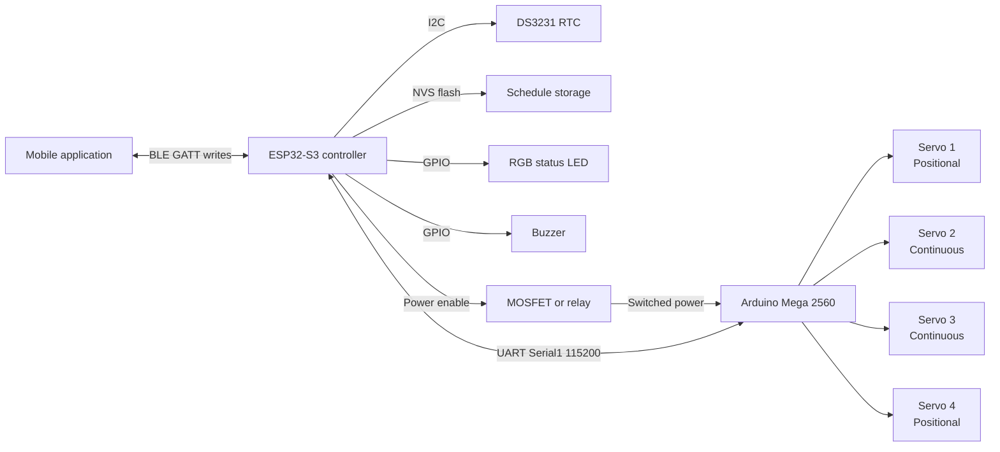
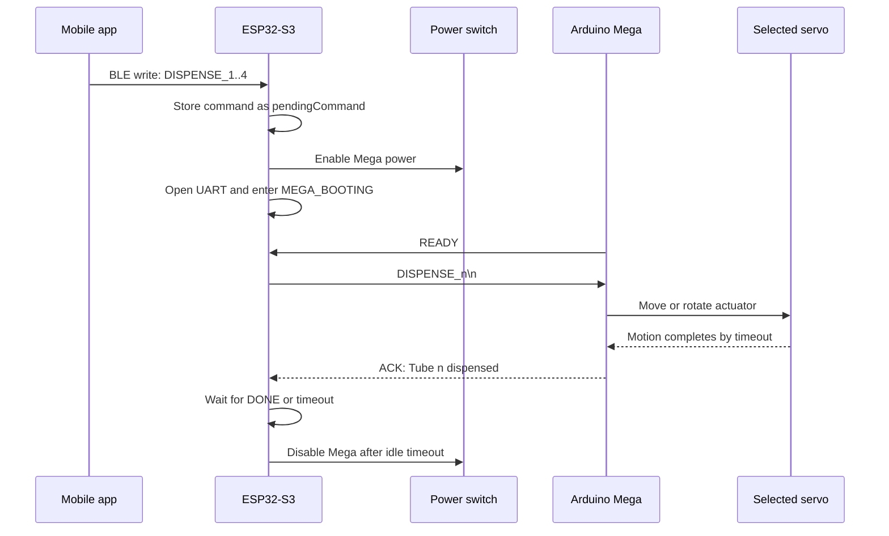
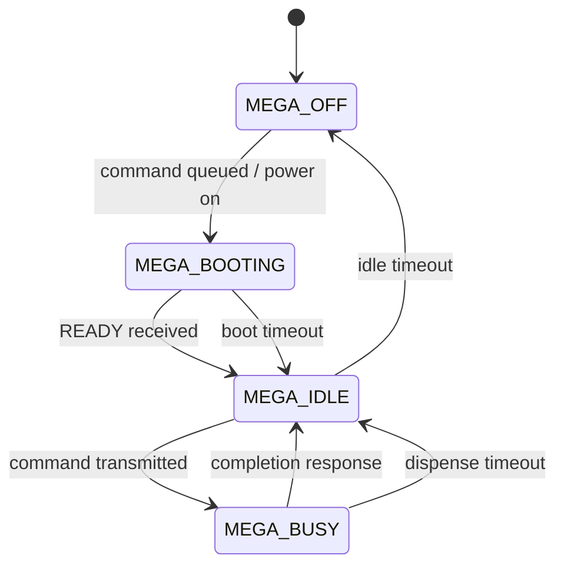
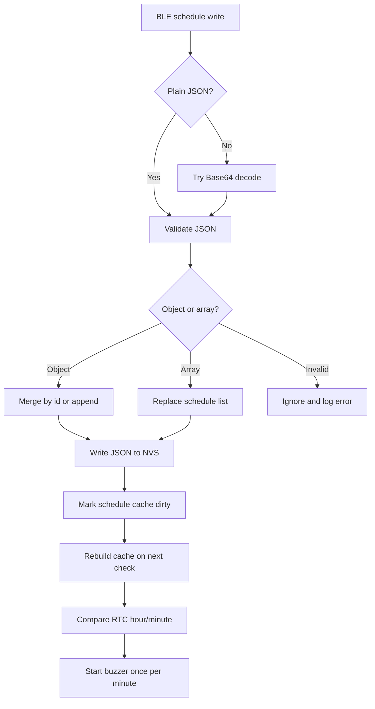

# Sadia Hardware

## Project overview

Sadia Hardware is the embedded-control firmware for a smart, four-channel pill dispenser. The system combines an ESP32-S3 supervisory controller with an Arduino Mega 2560 actuator controller.

The ESP32-S3 provides the user-facing and time-aware features:

- Bluetooth Low Energy (BLE) command reception.
- Schedule storage in non-volatile storage (NVS) flash.
- Real-time clock (RTC) integration through a DS3231-compatible device.
- Alarm indication through a buzzer.
- Status indication through an addressable RGB LED.
- On-demand power control for the Arduino Mega.
- UART communication with the Mega.

The Arduino Mega controls four servos and performs the physical dispensing action. Keeping the actuator logic separate from the BLE and scheduling logic creates a two-controller architecture with a clear separation between coordination and motion control.

> **Repository status:** This documentation reflects the repository structure and source code on the `main` branch as inspected on October 15, 2026. The repository is implemented entirely in C++/Arduino-oriented source files and is built with PlatformIO.

## Goals

1. Receive manual dispense commands over BLE.
2. Store medication schedules locally so they survive an ESP32 restart.
3. Track time independently using a hardware RTC.
4. Alert the user when a schedule becomes due.
5. Power the Mega only when dispensing is required.
6. Control two positional servos and two continuous-rotation servos.
7. Provide simple serial diagnostics for commissioning and troubleshooting.

## Non-goals and current limitations

The current firmware is a hardware prototype rather than a complete medical-device platform. The repository does not currently demonstrate:

- Dose verification using an optical, load-cell, or position sensor.
- A user-visible acknowledgement that a pill physically exited the dispenser.
- Encrypted or authenticated BLE writes.
- A formal command-response protocol with message IDs and retries.
- A comprehensive automated hardware-in-the-loop test suite.
- A persistent event log for missed, completed, or failed doses.
- Battery, brownout, or low-power policy beyond switching the Mega off when idle.

These limitations are important if the project is used for medication-critical workflows.

## System architecture



### Controller responsibilities

| Component | Responsibility | Main implementation |
|---|---|---|
| ESP32-S3 | BLE, schedules, RTC, buzzer, LED, power sequencing, UART coordination | `src/main.cpp` |
| Arduino Mega 2560 | Servo attachment, homing, dispensing motion, actuator-side serial parsing | `mega.ino/mega.ino.ino` |
| DS3231-compatible RTC | Timekeeping for schedule checks | `RTClib` and `RTC_DS3231` |
| NVS flash | Persistent JSON schedule list | ESP32 `Preferences` API |
| BLE client | Manual commands, time synchronization, schedule updates | BLE GATT writes |

## Repository layout

```text
.
├── platformio.ini              # PlatformIO environment and dependencies
├── src/
│   ├── main.cpp                # ESP32-S3 application
│   ├── DispenserControl.h      # Reusable ESP32 servo-control interface
│   ├── DispenserControl.cpp    # Reusable ESP32 servo-control implementation
│   ├── Sadia.code-workspace    # VS Code workspace
│   └── stepper.code-workspace  # Related workspace configuration
├── mega.ino/
│   └── mega.ino.ino            # Arduino Mega actuator firmware
├── include/README              # PlatformIO include-directory guidance
├── lib/README                  # PlatformIO private-library guidance
└── test/README                 # PlatformIO test-directory guidance
```

`src/main.cpp` is the active ESP32 application. `DispenserControl.*` provides an additional servo abstraction for ESP32-based servo experiments or future consolidation. The Mega firmware is currently maintained as a separate Arduino sketch under `mega.ino/`.

## Runtime behavior

### ESP32 startup

1. Start the USB serial console at 115200 baud.
2. Initialize I2C on GPIO 8 and GPIO 9.
3. Find the RTC and set it to compile time if the RTC reports lost power.
4. Print persisted schedules from NVS.
5. Configure the Mega power switch in the off state.
6. Configure the buzzer and RGB LED.
7. Start the BLE server and advertise the configured service UUID.

If the RTC cannot be found, the current implementation remains in an infinite delay loop. This is safe against operating without a clock, but it prevents manual BLE dispensing from being available when the RTC is disconnected.

### Manual dispense flow



The ESP32 state machine is:



### Schedule flow

Schedules are received through the schedule BLE characteristic as either:

- A JSON object to insert or replace by `id`.
- A JSON array to replace the complete schedule list.
- Base64-wrapped JSON, for compatibility with clients that encode payloads.

The schedule list is stored under the NVS namespace `sadia` using the key `schedules`. At runtime, the JSON is parsed into a fixed cache of up to 16 entries. The RTC is polled approximately once per second, and a matching hour/minute starts the buzzer.



### Actuator behavior

The Mega firmware maps commands as follows:

| Command | Actuator | Motion model |
|---|---|---|
| `DISPENSE_1` | Servo 1 | Move to 90°, hold for 2 seconds, return to 0° |
| `DISPENSE_2` | Servo 2 | Rotate at command value 130 for 800 ms, then stop at 90 |
| `DISPENSE_3` | Servo 3 | Rotate at command value 130 for 800 ms, then stop at 90 |
| `DISPENSE_4` | Servo 4 | Move to 90°, hold for 2 seconds, return to 0° |
| `HOME` | All servos | Return positional servos to 0 and stop continuous servos |

The positional and continuous-rotation mechanisms are time-based. They do not currently use feedback sensors.

## BLE interface

The ESP32 creates one BLE service with three write-only characteristics:

| Characteristic | Purpose | Example payload |
|---|---|---|
| Command | Manual action and maintenance commands | `DISPENSE_1`, `TEST_BUZZER` |
| Time sync | Binary seven-byte RTC update | Year, month, day, hour, minute, second, day-of-week |
| Schedule | Schedule JSON, Base64 JSON, or text commands | `{\"id\":\"morning\",\"hour\":8,\"pills\":2}` |

Supported text commands include:

- `DISPENSE_1`
- `DISPENSE_2`
- `DISPENSE_3`
- `DISPENSE_4`
- `LIST_SCHEDULES`
- `CLEAR_SCHEDULES`
- `TEST_BUZZER`
- `STOP_BUZZER`

### Schedule payload examples

Single schedule object:

```json
{
  "id": "morning",
  "hour": 8,
  "minute": 30,
  "period": "AM",
  "pills": 2
}
```

An array replaces the stored list:

```json
[
  {"id":"morning","hour":8,"minute":30,"period":"AM","pills":2},
  {"id":"evening","time":"20:00","pills":1}
]
```

The parser accepts either a 24-hour `time` value such as `20:00` or an hour with an optional `AM`/`PM` period. If `minute` is omitted, the schedule defaults to minute `00`.

## Hardware and pin assignments

### ESP32-S3

| Function | GPIO or interface |
|---|---:|
| RGB LED data | GPIO 48 |
| Mega UART RX definition | GPIO 17 |
| Mega UART TX definition | GPIO 18 |
| Mega power control | GPIO 4 |
| Buzzer | GPIO 13 |
| RTC I2C SDA | GPIO 8 |
| RTC I2C SCL | GPIO 9 |

The source names `MEGA_RX_PIN` and `MEGA_TX_PIN` should be checked against the board-level wiring. UART naming is easy to reverse because a controller's RX connects to the other device's TX.

### Arduino Mega 2560

| Servo | Pin | Type |
|---|---:|---|
| Servo 1 | 2 | Positional |
| Servo 2 | 3 | Continuous rotation |
| Servo 3 | 4 | Continuous rotation |
| Servo 4 | 5 | Positional |

The Mega communicates with the ESP32 through `Serial1` at 115200 baud. The ESP32 switches Mega power using a MOSFET or relay-style control signal.

## Build and development

### Prerequisites

- Visual Studio Code with PlatformIO.
- ESP32-S3 DevKit-compatible board.
- Arduino Mega 2560 and its Arduino toolchain.
- Connected RTC, buzzer, LED, power switch, and servos for hardware testing.

### ESP32 build

```bash
pio run -e esp32-s3-devkitm-1
```

Upload to the configured ESP32 board:

```bash
pio run -e esp32-s3-devkitm-1 -t upload
```

Monitor serial output:

```bash
pio device monitor -b 115200
```

### Mega build

Open `mega.ino/mega.ino.ino` in the Arduino IDE, select an Arduino Mega 2560, select the correct serial port, and upload the sketch. Confirm that the Mega's UART wiring and logic levels are safe before connecting it to the ESP32.

## Dependencies

The PlatformIO environment declares libraries including:

- Adafruit NeoPixel.
- ArduinoJson.
- ESP32Servo.
- RTClib and Makuna RTC packages.
- ModbusMaster, TMCStepper, and Stepper packages for related or planned hardware functionality.

Not every declared dependency is visibly used by the current `src/main.cpp`. Removing unused dependencies can shorten dependency resolution and reduce maintenance, but keeping them may support nearby experiments or planned features.

## Design trade-offs

### Two microcontrollers vs. one microcontroller

**Chosen approach:** ESP32-S3 for connectivity and scheduling plus Mega 2560 for servo control.

**Advantages**

- Separates BLE/network-facing code from timing-sensitive actuator code.
- Provides more GPIO and servo-library familiarity on the Mega.
- Allows the actuator subsystem to be tested independently.
- Lets the Mega remain completely powered down between dispensing sessions.

**Costs**

- Requires two firmware images, two boot processes, and inter-controller wiring.
- Adds UART protocol failure modes.
- Requires power sequencing and protection against back-powering through UART pins.
- Makes updates and diagnostics more complicated.

**Alternative:** A single ESP32-S3 could control BLE, scheduling, and all servos. This would simplify deployment and communication, but it would increase coupling and may require careful timer/resource management.

### On-demand Mega power vs. always-on Mega

**Chosen approach:** Power the Mega on only when a command is pending and turn it off after an idle grace period.

**Advantages**

- Reduces idle power consumption.
- Ensures the actuator controller starts from a known homed state.
- Allows the ESP32 to remain the always-on coordinator.

**Costs**

- Every dispense incurs a boot delay.
- Mechanical state can be lost when power is removed.
- A relay or MOSFET introduces electrical and failure considerations.
- The startup handshake must be reliable.

### Time-based servo control vs. feedback-controlled motion

**Chosen approach:** Fixed angles, speeds, and delays.

**Advantages**

- Low hardware cost.
- Simple implementation and calibration.
- No sensor integration or signal processing required.

**Costs**

- Accuracy varies with battery voltage, load, friction, servo manufacturing differences, and pill geometry.
- A jam may be reported as a successful dispense.
- Continuous-rotation servos can drift and require calibration.

**Alternative:** Add limit switches, optical gates, current sensing, or a load cell. This improves verification but increases cost, mechanical complexity, and calibration effort.

### JSON schedule storage vs. a binary record format

**Chosen approach:** Store a JSON array in NVS.

**Advantages**

- Human-readable serial diagnostics.
- Flexible schema evolution.
- Easy integration with mobile applications.

**Costs**

- More bytes per schedule.
- JSON parsing consumes RAM and CPU.
- Rewriting the full array can increase flash wear.
- The current cache has a hard limit of 16 entries.

**Alternative:** Store fixed-size binary records or use a small append-only journal. This improves compactness and write control but makes debugging and migration more difficult.

### Write-only BLE characteristics vs. acknowledged protocol

**Chosen approach:** BLE writes trigger actions and diagnostics are primarily printed to serial.

**Advantages**

- Minimal BLE implementation.
- Simple mobile-client integration.
- No notification state machine is required.

**Costs**

- The client cannot reliably know whether a command was accepted, completed, or physically verified.
- Duplicate writes can cause duplicate actions.
- There is no request ID, replay protection, authentication, or retry contract.

**Recommended evolution:** Add a read/notify status characteristic carrying a request ID, state, error code, and completion result.

## Reliability and safety considerations

Before using the system for real medication delivery, address the following:

1. **Fix completion semantics.** The ESP32 state machine currently waits for a response beginning with `DONE`, while the Mega sketch sends responses beginning with `ACK:`. This mismatch can cause the ESP32 to wait until `MEGA_DISPENSE_TIMEOUT_MS` even when the Mega completed the motion. Standardize the protocol, for example with `READY`, `ACCEPTED <id>`, `DONE <id>`, and `ERROR <id> <code>`.
2. **Add command correlation.** Include a monotonically increasing request ID so stale UART responses cannot complete a newer request.
3. **Prevent command replacement.** `queueMegaCommand` replaces an existing pending command. Use a queue or explicitly reject a second command while the Mega is busy.
4. **Add actuator feedback.** Time-based motion alone cannot prove that a pill was dispensed.
5. **Validate schedule limits.** Enforce maximum schedule count, valid pill counts, duplicate IDs, and maximum serialized payload size before writing to NVS.
6. **Secure BLE writes.** Pairing, bonding, authenticated writes, or an application-level authorization token should be considered.
7. **Handle RTC failure explicitly.** Consider exposing RTC health to the client instead of blocking forever in `setup()`.
8. **Protect the power interface.** Confirm common ground, voltage compatibility, relay/MOSFET polarity, flyback protection, and that UART lines cannot back-power the unpowered Mega.
9. **Define recovery behavior.** On reset during a dispense, decide whether to home, stop, retry, or require user intervention.
10. **Test missed schedules.** Define behavior when the ESP32 is off, the RTC is wrong, the buzzer is already active, or multiple schedules match the same minute.

## Testing strategy

### Unit-level tests

Test without hardware where possible:

- AM/PM to 24-hour conversion, including 12 AM and 12 PM.
- `time` parsing and invalid time rejection.
- Schedule object merge by `id`.
- Full-array replacement.
- Base64 decoding and malformed payload handling.
- Duplicate-trigger prevention within the same minute.
- UART response parsing and timeout transitions.

### Hardware tests

- RTC detection and power-loss recovery.
- BLE connection, disconnect, and advertising restart.
- Mega power-on handshake.
- Mega power-off without UART back-powering.
- Each servo's home position and dispense calibration.
- Buzzer duration and stop command.
- LED states for disconnected, connected, and command activity.
- Recovery after ESP32 reset during Mega boot or dispensing.

### Suggested acceptance criteria

- A valid manual command is executed at most once per request.
- An invalid BLE payload never energizes a servo.
- The Mega is powered off after the configured idle timeout.
- A completed dispense is distinguishable from a timeout.
- Schedules survive an ESP32 restart.
- A schedule cannot trigger twice during the same RTC minute.
- A failed RTC or actuator is reported to the client and serial diagnostics.

## Future roadmap

1. Define and implement a versioned ESP32-to-Mega protocol.
2. Add BLE status notifications and authenticated access.
3. Replace blocking `delay()` motion with non-blocking state machines.
4. Add physical dispense verification sensors.
5. Add a persistent dose event log.
6. Add a configuration layer for servo calibration instead of compile-time constants.
7. Add PlatformIO unit tests for parsers and protocol state transitions.
8. Add hardware-in-the-loop tests for power sequencing and servo behavior.
9. Consolidate or clearly separate experimental dependencies and source files.
10. Document the electrical schematic, connector pinout, and mechanical calibration procedure.

## Summary

Sadia Hardware uses the ESP32-S3 as a connected, time-aware supervisor and the Arduino Mega 2560 as a dedicated four-servo actuator controller. The architecture is understandable and practical for a prototype: BLE and scheduling stay on the ESP32, while motion control stays on the Mega. The most important next step is to make the inter-controller protocol explicit and reliable, especially the completion-response mismatch, command correlation, timeout handling, and physical dose verification.
